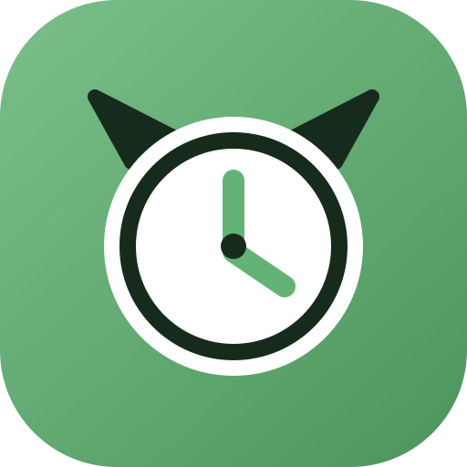

# EvilTime

<p align="center"></p>

EvilTime is a self-hosted project time-tracking system. It keeps attendance and project tracking in one workflow: users clock directly into a project and clock out when they are finished.

## What is different in EvilTime?

- Every running timer belongs to a project. There is no separate general-attendance clock.
- Teams can create their own catch-all project for internal or general work; no project name is hardcoded.
- Each user can choose a default project in **My Settings → Work tracking**.
- Starting a timer without an explicit project uses that default when it is available and active.
- Timers are never stopped because a browser tab went idle. They end when the user clocks out, or through the automatic clock-out below.
- Automatic clock-out: when a user's standard hours per day are reached, they get a reminder on the dashboard, as a browser notification, and in Slack, and can extend the day by 15 minutes, 30 minutes, or 1 hour. Without a reaction within 15 minutes the timer stops at the moment the hours were reached. Users can turn this off under **My Settings → Overtime**.
- Slack workspace integration: employees clock in, switch projects, take breaks, and clock out with `/in`, `/switch`, `/brb`, `/back`, and `/out`. Changes made on the website, kiosk, API, or MCP are announced in the same Slack channel. See [`docs/integrations/SLACK_ATTENDANCE.md`](docs/integrations/SLACK_ATTENDANCE.md).
- Weekly time can be reviewed and corrected while keeping the underlying project entries visible.
- Weekly expected hours are schedule changes: set them once in the weekly overview and later weeks inherit them until the next change. Administrators can manage the same ledger for each user.
- Browser notifications can remind a user when a 30-minute break is over.
- Projects can use an emoji or uploaded PNG icon for one-click recent-project actions on the dashboard.
- The dashboard includes a fixed-day event timeline for clock-ins, project switches, breaks, and clock-outs. Events can be edited, dragged, or inserted retroactively.
- Every user can create a private MCP connection for timer control, projects, reporting, and retry-safe historical imports.
- Durations are displayed as hours and minutes (`7:30h`) instead of decimal hours (`7.50h`).
- The UI, metadata, manifests, and frontend package are branded as EvilTime.

EvilTime also retains the broader project, task, client, reporting, invoicing, API, authentication, and administration capabilities inherited from the upstream application.

## Production deployment (Coolify)

Production runs on [Coolify](https://coolify.io) and is deployed from the **`coolify`** branch. There is no
command-line deployment; everything is configured in the Coolify dashboard.

| Coolify setting | Value |
|-----------------|-------|
| Repository | `https://github.com/theGoodEvil/TimeTracker` |
| Branch | `coolify` |
| Build pack | Docker Compose |
| Compose file | `docker-compose.example.yml` (builds the image from this repository and starts PostgreSQL) |
| Domain | Assigned to the `app` service, container port `8080` |

Set these environment variables in Coolify before the first deploy:

- `SECRET_KEY` — required; generate one with `python -c "import secrets; print(secrets.token_hex(32))"` and never
  change it afterwards (sessions and CSRF tokens depend on it).
- `ADMIN_USERNAMES` — the first name becomes the initial administrator.
- `TZ` — timezone for timestamps (default `Europe/Brussels`).
- For HTTPS through Coolify's proxy: `SESSION_COOKIE_SECURE=true`, `REMEMBER_COOKIE_SECURE=true`,
  `CSRF_COOKIE_SECURE=true`, and `PREFERRED_URL_SCHEME=https`.

The application container runs database migrations during startup, and data lives in the `db_data`, `app_data`,
and `app_uploads` volumes.

## Run locally with Docker

For an isolated SQLite test instance on plain HTTP (requires Docker Engine 20.10+ and Docker Compose v2):

```bash
git clone https://github.com/theGoodEvil/TimeTracker.git
cd TimeTracker
docker compose -f docker/docker-compose.local-test.yml up --build
```

Open `http://localhost:8080`. This mode is intended for development and evaluation, not production.

## Run directly for development

Native development uses Python 3.11 and Node.js 18 or newer. The commands below use SQLite, build the frontend assets, apply migrations, and start Flask on port 8080.

```bash
python3.11 -m venv .venv
source .venv/bin/activate
pip install -r requirements.txt
npm install
npm run build:assets
mkdir -p instance logs
export FLASK_ENV=development
export FLASK_DEBUG=true
export SECRET_KEY=eviltime-local-development-secret-key
export DATABASE_URL="sqlite:///$PWD/instance/eviltime.db"
export AUTH_METHOD=local
export ADMIN_USERNAMES=admin
flask --app app.py db upgrade
python app.py
```

Open `http://localhost:8080`. For production, use PostgreSQL and a production WSGI deployment such as the included Docker stack.

When frontend source files change, rebuild them with:

```bash
npm run build:assets
```

## First-time setup

The first username in `ADMIN_USERNAMES` is the initial administrator. With local authentication, sign in as that user and set a password when prompted. Then:

1. Create the projects your team may clock into, including any desired internal/general project.
2. Assign project access and permissions to users.
3. Have each user select a default project under **My Settings → Work tracking**.
4. Review timezone, rounding, authentication, backups, and module visibility under **Admin → Settings**.

## Updating an installation

1. Merge the changes into `main`, then merge `main` into `coolify` and push.
2. Coolify builds and deploys the new revision (automatically when auto-deploy is enabled for the resource,
   otherwise with **Deploy** in the Coolify dashboard).
3. Watch the deployment and application logs in Coolify. Pending Alembic migrations are applied on startup.

Back up the database before deploying changes that include migrations. Do not delete the resource's volumes unless
you intentionally want to remove all data.

## EvilTime versions

EvilTime keeps the compatible upstream numeric version and adds an `-evil` suffix, starting at `5.11.4-evil`. The version lives in [`EVILTIME_VERSION`](EVILTIME_VERSION) and can be overridden for a build with the `EVILTIME_VERSION` environment variable. Upstream update reminders are intentionally disabled.

## Connect an MCP agent

Each user can open **My Settings → MCP integration** at the bottom of their settings, create a short-lived token, and copy the displayed Streamable HTTP configuration into their agent. The MCP server is scoped to that user and exposes their timer, available projects, completed entries, and retry-safe batch imports. Use the import tool with `dry_run: true` before writing historical data.

The endpoint is `/mcp`. Authentication uses the generated token as `Authorization: Bearer <token>`; the token is shown only once and should not be committed to source control.

## Tests and checks

```bash
source .venv/bin/activate
pytest
python scripts/check_silent_excepts.py
npm run build:assets
```

## Configuration and documentation

- [`env.example`](env.example) documents the principal environment variables.
- [`docs/integrations/SLACK_ATTENDANCE.md`](docs/integrations/SLACK_ATTENDANCE.md) explains the Slack app setup, the automatic clock-out, and troubleshooting.
- [`docs/`](docs/) contains the inherited administration, security, API, backup, and deployment guides.
- [`CHANGELOG.md`](CHANGELOG.md) contains the upstream release history and project changes.
- [`UNINSTALL.md`](UNINSTALL.md) explains how to remove an installation and its data.

Some inherited documents still use the original TimeTracker name where they describe unchanged upstream subsystems.

## Fork attribution

EvilTime is a fork of [DRYTRIX/TimeTracker](https://github.com/DRYTRIX/TimeTracker). We are grateful to the original maintainers and contributors for the application this work builds upon.

EvilTime-specific changes are maintained in [theGoodEvil/TimeTracker](https://github.com/theGoodEvil/TimeTracker).

## License

This project remains available under the upstream license. See [`LICENSE`](LICENSE) for the full terms and copyright notices.
